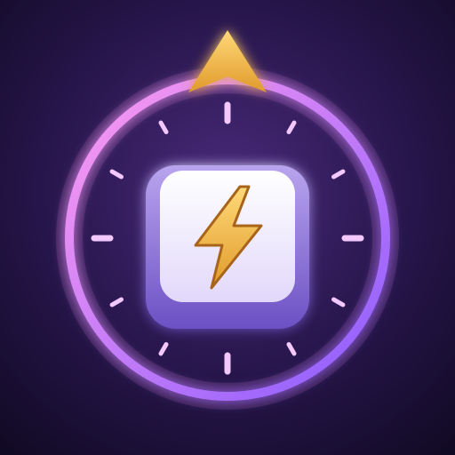

<p align="center">
  
</p>

<h1 align="center">Keybound Brawler Autopilot</h1>

<p align="center">
  <a href="https://github.com/Sojiroh/FFXIV-KeyboundBrawlerAutopilot/releases/latest"></a>
  <a href="https://github.com/Sojiroh/FFXIV-KeyboundBrawlerAutopilot/releases"></a>
  <a href="https://github.com/Sojiroh/FFXIV-KeyboundBrawlerAutopilot/actions/workflows/release.yml"></a>
  <a href="LICENSE.md"></a>
</p>

<p align="center">
  <em>Keybound Brawler, typed for you. Built on Dalamud.</em>
</p>

---

> **Fork notice.** Keybound Brawler Autopilot is a fork maintained by Sojiroh. It is not affiliated with or endorsed by XeldarAlz. Report problems here, not to the original author.
>
> ```text
> Based on Auto Keybound Brawler by XeldarAlz
> https://github.com/XeldarAlz/FFXIV-AutoKeyboundBrawler
> ```

## What it does

Plays the typing for you in **Keybound Brawler**, the Gold Saucer's FINAL FANTASY VII typing event. Press **Start**, queue at the Keybound Registrar in Keybound Square, and the plugin reads the phrases above the enemies and sends the most urgent one in after as long as typing it would take, wave after wave.

## Features

- Reads every phrase on screen straight from the game's own UI, no screen capture or OCR.
- Two input methods: Submit directly (the default), which sends each word after a typing-length wait and needs no input bar focus, or Type keys, real key presses into the input bar followed by Enter.
- With Type keys, keeps the brawler's input bar focused, waking it the way a player does (the first key of the next phrase) whenever it loses focus. It never takes focus from chat or another text box, in the game or in a plugin window, while you are typing there, and never types into one, so a phrase is never sent to chat.
- Every key waits for the input bar to show it before the next one goes out, and a wrong or leftover letter is erased with Backspace before Enter is pressed.
- Handles the special attacks: types the words over the barrier first during a Barrier Buster, goes after casting enemies next (interruptible ones first), keeps a word going while a debuff hides it, and holds still for Letterlock casts such as Cursed Gaze so your inputs are never locked.
- A Target priority setting for everything else: Smart (closest to the barrier first, shortest first once the screen gets crowded), Closest first or Shortest first. A phrase that keeps going in with no visible effect steps aside for a few seconds.
- Reads the brawler's own word list from the game, so barrier words, casting enemies and Japanese readings are never guessed from the screen, and words of defeated enemies are skipped.
- Auto queue: closes the results, walks to the Keybound registrar (with vnavmesh when installed), registers and accepts the duty, match after match, stopping after a set number of matches or before the 10,000 MGC cap. MGC and MGP earned are tracked per session and in total.
- Four typing speeds, from a relaxed 60 words a minute to as fast as the game takes keys.
- A humanizer with random reaction pauses before each new phrase and before Enter, both ranges adjustable, plus optional occasional typos that get corrected. All of it can be switched off.
- A status card with a progress ring for the phrase being typed and the Letterlock countdown, a live board of the phrases and casts on screen, quick settings beside it, and session stats (phrases, words per minute, time).
- Skips the punctuation the game marks as optional (? ! - ') and types Japanese phrases as their hiragana reading.
- A single app window with Brawl, Settings, Console, Changelog and About pages, plus a compact header-bar mode.
- Every theme from [Glasswork](https://www.nuget.org/packages/Glasswork.Dalamud), the UI toolkit the window is built on (Neutral, Liquid, Eorzea, Classic, the four Clear themes, Aurora, Catppuccin, Nord and more), dark or light, under Settings, General. The Clear, Liquid, Eorzea and Aurora themes are real glass over the game.
- Nine interface languages, picked automatically on first run and changeable under Settings, General.

## Languages

English, Français, Deutsch, Türkçe, Español, Português (Brasil), Русский, 日本語, 中文.

The plugin picks one on first run from your Dalamud interface language, then your game client, then your OS, falling back to English. Change it any time under **Settings → General → Language**. Phrases are always typed exactly as your game client shows them.

## What changed

This fork differs from the original Auto Keybound Brawler as follows:

- Renamed from Auto Keybound Brawler to **Keybound Brawler Autopilot**.
- New internal name `KeyboundBrawlerAutopilot`, so it installs alongside the original and does not reuse its settings or its lifetime match and coin totals. Configure it again after switching.
- Commands are now `/kba` and `/keyboundautopilot`, and log and chat lines are tagged `[KBA]`.
- Published through Sojiroh's custom repository.
- The original author's Discord, Patreon and Buy Me a Coffee links were removed.
- The Glasswork link points to its NuGet package, since its GitHub repository is gone.
- New icon.

## Install

In-game: `/xlsettings` → **Experimental** → paste into **Custom Plugin Repositories**:

```
https://sojiroh.github.io/SojirohPlugins/pluginmaster.json
```

Tick **Enabled**, click **+**, then **Save and Close**. Open `/xlplugins` → **All Plugins**, search for **Keybound Brawler Autopilot**, and install.

## Commands

| Command              | Action                       |
| -------------------- | ---------------------------- |
| `/kba`               | Toggle the main window       |
| `/keyboundautopilot` | Alias for `/kba`             |
| `/kba start`         | Turn auto typing on          |
| `/kba stop`          | Turn auto typing off         |
| `/kba toggle`        | Switch auto typing on or off |
| `/kba config`        | Open the Settings page       |
| `/kba log`           | Open the Console page        |
| `/kba changelog`     | Open the Changelog page      |
| `/kba about`         | Open the About page          |

## License

AGPL-3.0-or-later. See [LICENSE.md](LICENSE.md). See [NOTICE](NOTICE) for the original copyright and the additional terms the AGPL allows: a fork, or any project that reuses this code, must credit the original author and must not pass itself off as the original. The license covers the code, not the name or the icon: read the [trademark and naming policy](TRADEMARK.md) before you publish a fork.

## About this source

The original repository (`XeldarAlz/FFXIV-AutoKeyboundBrawler`) and the `XeldarAlz/DalamudPlugins` repository were taken down in late October 2026. This fork starts from a reconstruction of release **1.5.2.0** (upstream commit `05abf15`), recovered from the installed plugin build:

- `AutoKeyboundBrawler/` was decompiled from `AutoKeyboundBrawler.dll` with ILSpy and rewritten by hand. Type, member, parameter and constant names are the originals. Local variable names were not in the binary and were chosen from usage. Comments and XML docs are lost, and member order inside a type follows the decompiler rather than the original files.
- Before the rebrand, built with the official .NET SDK 10.0.403, every one of the 1,255 method bodies compiled to the same IL as the shipped 1.5.2.0 DLL. Other SDK builds (e.g. a distro-packaged SDK) can lay out branches differently but behave the same.
- `Localization/` and `Fonts/` come from the shipped build. The localization files have the fork's command names and drop the removed Discord and support strings.
- `ECommons` is pinned to `509c89b`, the commit the shipped `ECommons.dll` was built from. Glasswork comes from NuGet (`Glasswork.Dalamud` `0.1.0-beta.2`).
- The original README was restored from the Wayback Machine capture of 29 October 2026 (the demo GIF was not recovered). `NOTICE` and `TRADEMARK.md` were rewritten from the same author's templates in FFXIV-AutoPVPSeriesGrind to carry the terms the original README describes.

Build with `dotnet build -c Release` from the repository root (needs the .NET 10 SDK and a Dalamud dev install: `~/.xlcore/dalamud/Hooks/dev` on Linux, or set `DALAMUD_HOME`). The packaged plugin lands in `AutoKeyboundBrawler/bin/Release/KeyboundBrawlerAutopilot/latest.zip`.
